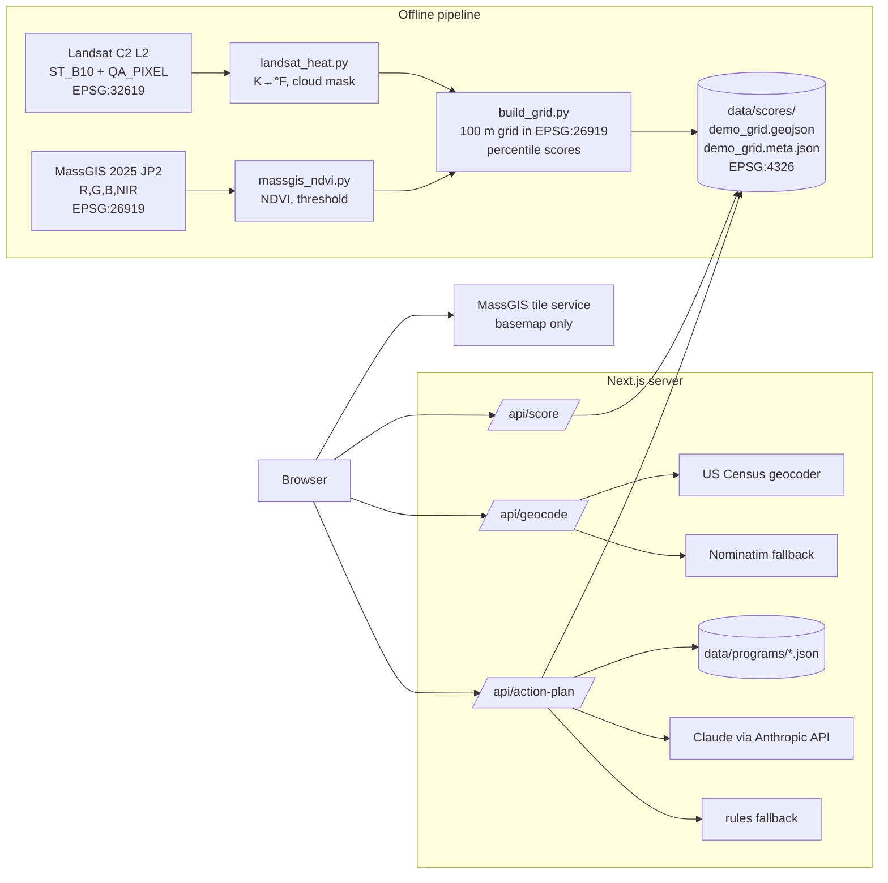

# Design: BetterBoston MVP

## Overview

Two parts, connected only by files:

1. **Offline pipeline** (Python, `pipeline/`), run once before the demo. It turns Landsat and MassGIS imagery into `data/scores/demo_grid.geojson` + `demo_grid.meta.json`.
2. **Web app** (Next.js 16 App Router, `app/` + `lib/`). It reads those files, geocodes addresses, and builds the action plan with Claude or a rule-based fallback.

There is no database. Every external call happens server-side.

## Architecture



## Data flow for one report

1. Home page → `GET /api/geocode?q=…` → `LocationResult {lat, lng, label}` → navigate to `/report?lat&lng&q`.
2. Report page (server component) → `lookupScore(lng, lat)`, or `GET /api/score` → `ok | no_data | out_of_coverage`.
3. Client wrapper → `POST /api/action-plan {cell_id, tenure}` → `ActionPlan`. Toggling tenure sends a new request, which may come from cache.

## GeoJSON schema (`data/scores/demo_grid.geojson`)

FeatureCollection in EPSG:4326. Each feature is a `Polygon` (one grid cell) with these properties (`ScoreCellProperties` in `lib/types.ts`):

| Field | Type | Meaning |
|---|---|---|
| `cell_id` | string | Unique, stable id |
| `bbox` | [minLng, minLat, maxLng, maxLat] | Used for a fast reject before point-in-polygon |
| `neighborhood` | string | e.g. "Chinatown" |
| `mean_surface_temp_f` | number \| null | Mean °F of valid Landsat pixels |
| `temp_diff_f` | number \| null | Cell mean − reference mean. Positive = hotter |
| `pct_vegetated` | number \| null | 0-100, share of valid pixels with NDVI above the threshold |
| `heat_score` | number \| null | 0-100 percentile, higher = hotter |
| `tree_score` | number \| null | 0-100 percentile, higher = greener |
| `heat_valid_frac` | number | 0-1 |
| `tree_valid_frac` | number | 0-1 |
| `is_sample` | boolean | Must equal `metadata.is_sample` |

### Metadata (`demo_grid.meta.json`, `ScoreMetadata`)

`schema_version`, `is_sample`, `generated_at`, `generated_by`, `area {name, neighborhoods, bbox}`, `grid {cell_size_m, processing_crs, output_crs, cell_count}`, `heat {source, scene_id, scene_date, reference_area, reference_mean_f, min_valid_frac}`, `tree {source, imagery_dates, ndvi_threshold, leaf_off, reference_area, min_valid_frac}`, `sources[]`, `notes[]`.

## API routes

All routes return JSON. Errors are `ApiError {error, message}`, where `message` is plain English and safe to show to users.

### `GET /api/geocode?q=<address>`

| Status | Body |
|---|---|
| 200 | `LocationResult {lat, lng, label, source: "census" \| "nominatim"}` |
| 400 | `q` missing or longer than 200 characters |
| 404 | No match from any provider |
| 502 | Every provider failed with a network or HTTP error |

Behavior: appends ", MA" when the query has no "MA"/"Massachusetts" and no ZIP code. Tries Census, then Nominatim (bounded to a Massachusetts viewbox). 5-second timeout per provider.

### `GET /api/score?lat=<num>&lng=<num>`

| Status | Body |
|---|---|
| 200 | `{status: "ok", cell, geometry, metadata}` |
| 200 | `{status: "no_data", cell, geometry, metadata}`, when both scores are null |
| 200 | `{status: "out_of_coverage", metadata}` |
| 400 | Missing or invalid coordinates |
| 503 | Score files missing |

Lookup: bbox reject, then ray-casting point-in-polygon on the outer ring. Files are cached and reloaded when their modification time changes.

### `POST /api/action-plan`

Request: `{cell_id: string, tenure: "renter" | "owner"}`.

| Status | Body |
|---|---|
| 200 | `ActionPlan` |
| 400 | Invalid body |
| 404 | Unknown `cell_id` |
| 503 | Score or program files missing, or no verified programs |

`ActionPlan`:

```ts
{
  summary: string;
  actions: { title: string; why: string; program_id: string; link: string }[]; // 3-5
  tenure: "renter" | "owner";
  cell_id: string;
  source: "ai" | "rules";
  model_id: string;            // Claude model id, or "rules"
  generated_at: string;        // ISO 8601
  based_on_sample_data: boolean;
}
```

Pipeline:

1. Validate the body with zod.
2. `getCellById`: scores come from the server, never from the client.
3. `loadPrograms()`, which hides unverified programs, then `filterByTenure`.
4. Build the rules plan first. It is the fallback.
5. If `ANTHROPIC_API_KEY` is set: call Claude, then `validateModelPlan`. On success use it (`source: "ai"`). On any failure keep the rules plan.
6. Fill each `link` from the program record. Cache by `cell_id|tenure|generated_at|program ids`.

## Action plan prompt

**Transport:** `messages.create` with one tool, `submit_action_plan`, and `tool_choice: {type: "tool"}`, so Claude must answer with JSON matching the tool's `input_schema`. Model: `CLAUDE_MODEL`, default `claude-haiku-5-5`. `max_tokens` 1200. Timeout 30 s, 1 retry.

**System prompt** (`lib/actionPlanPrompt.ts`), in summary:

1. Recommend only programs in `<programs>`, by exact id, each at most once.
2. Never invent programs, phone numbers, emails, websites, dollar amounts, dates, deadlines, or eligibility rules.
3. Scores are relative, not official. Don't call a block "dangerous" or "safe."
4. Heat is ground surface temperature on one summer day, not air temperature.
5. Green cover comes from leaf-off spring photos. Call it "green cover."
6. Null score → "not enough clear data." Don't guess.
7. 8th-grade reading level, short sentences, "you."
8. Summary is 2-3 sentences. 3-5 actions, most useful first. Each title starts with a verb, and each "why" ties the program to this block's numbers.

**User message:** three tagged blocks:

```
<scores>{neighborhood, heat {mean_ground_surface_temp_f, difference_from_average_f, heat_score_0_to_100, compared_with, satellite_date}, green_cover {percent_of_block_green, tree_score_0_to_100, compared_with, photo_dates}}</scores>
<tenure>renter|owner</tenure>
<programs>[{id, name, description, topics, details?}]</programs>
```

Links are not sent to the model.

**Output schema** (the tool's `input_schema`, generated from zod in `lib/actionPlanSchema.ts`):

```json
{
  "type": "object",
  "required": ["summary", "actions"],
  "additionalProperties": false,
  "properties": {
    "summary": { "type": "string", "minLength": 1, "maxLength": 600 },
    "actions": {
      "type": "array", "minItems": 3, "maxItems": 5,
      "items": {
        "type": "object",
        "required": ["title", "why", "program_id"],
        "additionalProperties": false,
        "properties": {
          "title": { "type": "string", "minLength": 1, "maxLength": 120 },
          "why": { "type": "string", "minLength": 1, "maxLength": 400 },
          "program_id": { "type": "string", "minLength": 1 }
        }
      }
    }
  }
}
```

**Validation** (`validateModelPlan`):

- zod parse.
- Drop unknown or repeated `program_id`s. Fail if fewer than 3 remain.
- Fail if the text contains a dollar amount, phone number (`617-635-8733` or `866-527-SAVE` style), email, or URL that doesn't appear in the allowed programs' JSON.

## Rule-based fallback (`lib/actionPlanRules.ts`)

- Hot block (`heat_score ≥ 60`): cooling centers and alerts first.
- Low green cover (`tree_score ≤ 40`): street tree request next.
- Then energy (owners: heat pumps, assessment, income-eligible; renters: assessment, income-eligible), then solar (owners: rooftop, community; renters: community), then anything left over. Maximum 5 actions.
- "Why" lines use only the block's numbers and facts from the program descriptions.

## Programs (`data/programs/`)

Five files: `cooling_centers.json`, `tree_requests.json`, `mass_save_rebates.json`, `community_solar.json`, `rooftop_solar.json`. Each has the shape `ProgramFile {category, programs: Program[]}`, validated with zod at load time. Duplicate ids are an error.

A cool-roof program was planned for owners, but no official Massachusetts or Boston cool-roof incentive was found. It is left out rather than invented.

## Security

- `ANTHROPIC_API_KEY` is read only in `lib/config.ts`, used only in `lib/claude.ts`, and never logged or sent to the client.
- Inputs are validated and length-capped at every route. Model output is treated as untrusted data.
- Nominatim requests send an identifying User-Agent, as its usage policy requires.

## Error handling

| Failure | User sees |
|---|---|
| Geocoder down | "The address lookup service isn't responding. Try again in a moment." |
| Outside demo area | "Coverage coming soon" + covered neighborhoods |
| Score missing for a cell | "Not enough clear data for this block" |
| Claude down / bad output | Rules plan, same layout, without the "written by AI" label |
| Score files missing | 503 "Score data isn't loaded yet." |

## `GET /api/grid`

Every score cell, for coloring the map with real data.

| Status | Body |
|---|---|
| 200 | `GridResponse { type: "FeatureCollection", features: [{ geometry, properties: { cell_id, neighborhood, heat_score, tree_score, temp_diff_f, pct_vegetated, is_sample } }], metadata: { is_sample, generated_at, area, heat, tree } }` |
| 503 | Score files missing |

About 330 KB for 944 cells. Rebuilt only when the score files change.

## Live data

Public APIs called server-side, cached in memory, merged into one response. Code is in `lib/live/`, with the rules in `.kiro/steering/data.md`.

### `GET /api/live?lat=<num>&lng=<num>`

200 `LiveBundle`:

```ts
{
  lat, lng, fetched_at,
  weather: LiveResult<LiveWeather>,
  air:     LiveResult<LiveAir>,
  flood:   LiveResult<LiveFlood>,
  trees:   LiveResult<LiveTrees>,
  places:  LiveResult<LivePlaces>,
  area:    LiveResult<LiveArea>,
  climate: LiveResult<LiveClimate>,
}

type LiveResult<T> =
  | { ok: true; data: T; sources: { name: string; url: string }[]; fetched_at: string; note?: string }
  | { ok: false; error: "outside_coverage" | "unavailable" | "disabled"; message: string };
```

- **400** for bad coordinates.
- Points outside Massachusetts get `outside_coverage` for every source.
- Boston-only sources (`trees`, `places`, `climate`, the sea-level-rise part of `flood`, and the census tract in `area`) are `outside_coverage` elsewhere in Massachusetts.
- Each source has its own timeout (20 s). A slow or failed source never blocks the others.
- Typical response time: about 1-2 s cold, under 50 ms cached.

### `GET /api/live/<source>?lat&lng`

Same `LiveResult` for one source: `weather | air | flood | trees | places | area | climate`. Unknown source → 404.

### Source details

| Source | Upstream calls | Key fields |
|---|---|---|
| weather | NWS `/points` → `/forecast`, `/stations` → `/observations/latest`, `/alerts/active?point=`; Open-Meteo `/v1/forecast` | `observed.temperature_f`, `forecast[]`, `daily[]` (7 days), `hot_days_next_7`, `alerts[]`, `heat_alert`, `air_quality_alert` |
| air | Open-Meteo `/v1/air-quality` | `us_aqi`, `category`, `main_pollutant`, `max_aqi_next_24h`, `modeled: true` |
| flood | FEMA NFHL layer 28; Climate Ready Boston SLR layers 0-8 | `fema_zone`, `fema_high_risk`, `future[]` (9/21/36 in × high tide / 10% / 1% storm), `first_flooded_at_in` |
| trees | BPRD Trees FeatureServer, 100 m radius | `tree_count`, `empty_planting_sites`, `top_species`, `size_mix` |
| places | Community Centers, Community Center Pools, BPL branches (5 km search) | nearest 3 of each with `distance_mi` |
| area | BPDA neighborhoods (layer 5); Climate Ready Boston Social Vulnerability | `neighborhood`, `in_boston`, `tract.pct_*` |
| climate | `data/live/climate_boston.json` (built by `npm run build:climate`) | `last_summer`, `baseline_days_90f_per_year`, `projection` |

### Live data in the action plan

- `POST /api/action-plan` looks up the cell's center, then calls `getLiveFacts` with a 5 s timeout. Sources that don't answer in time are skipped.
- The facts go into `<live_conditions>` in the user prompt and into the validator's allowed-fact corpus.
- The rules fallback uses them too:
  - an active heat alert puts cooling centers and AlertBoston first and leads the summary
  - empty planting sites push the street tree request up
  - the nearest community center is named in the cooling center action
- `ActionPlan.live_sources_used` lists the sources that contributed. The plan cache key includes a signature of the live facts that change the plan (heat alert, AQI category, empty sites, nearest center).
