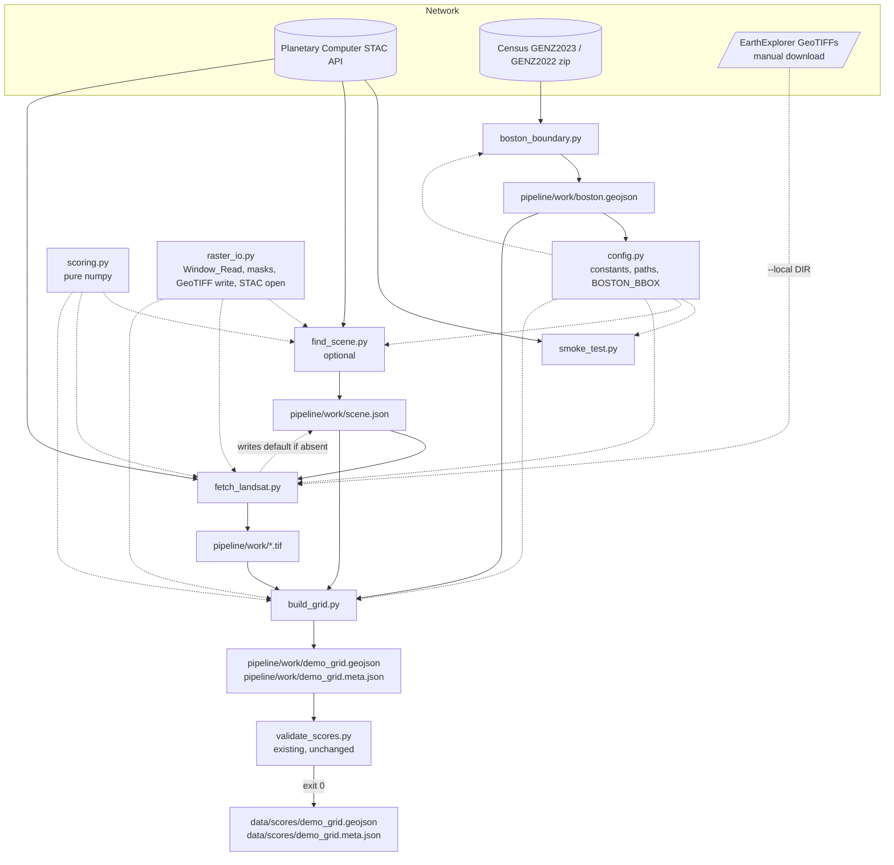
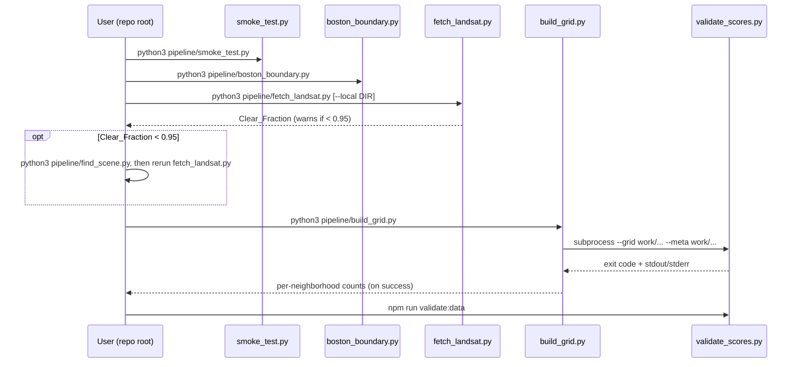
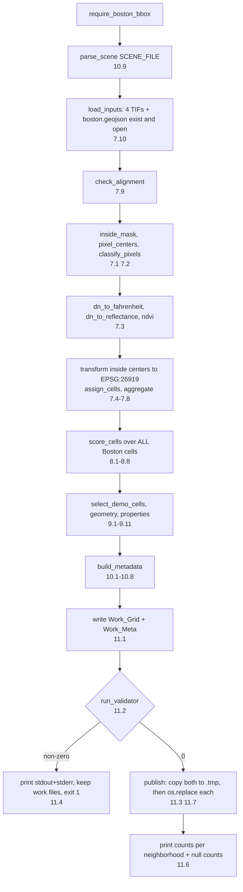

# Design Document: Landsat Data Pipeline

## Overview

This pipeline replaces the SAMPLE files in `data/scores/` with real values from one Landsat 8/9 Collection 2 Level-2 summer scene. It is a set of small Python 3 scripts in `pipeline/` that run in order from the repo root:

1. `smoke_test.py` checks that the STAC API works and that the four asset keys exist.
2. `boston_boundary.py` downloads the Census place file and saves the City of Boston polygon(s).
3. `fetch_landsat.py` reads a window around Boston from four bands of the chosen scene and saves them as GeoTIFFs in `pipeline/work/`.
4. `build_grid.py` turns the saved bands into 100 m cells, scores every Boston cell, keeps only cells in the three demo areas, writes candidate files to `pipeline/work/`, runs the existing validator, and publishes to `data/scores/` only if it passes.
5. `find_scene.py` is optional. Run it only when the default scene is too cloudy.

The output must match `ScoreGrid`, `ScoreCellProperties`, and `ScoreMetadata` in `lib/types.ts` exactly and pass `pipeline/validate_scores.py`. `lib/types.ts`, `make_sample_data.py`, `validate_scores.py`, and `package.json` are not changed.

### Design goals

- **Math is pure and tested offline.** Unit conversions, masks, ranking, cell assignment, aggregation, scoring, geometry, and metadata construction are pure functions that take numpy arrays or plain Python values. Scripts only do I/O and call these functions.
- **Match the sample data.** Ranking, rounding, key order, and JSON formatting follow `make_sample_data.py`, so the app works unchanged when real data arrives.
- **Fail before writing.** Every script checks all of its inputs before it writes anything. `data/scores/` changes only after the validator passes.
- **Read windows, never full scenes.** Raster reads go through one shared Window_Read helper.

### Research findings that shape the design

- **Planetary Computer `landsat-c2-l2`.** The collection is served as cloud-optimized GeoTIFFs through the STAC API, and asset hrefs must be signed with `planetary_computer.sign_inplace` before reading. Asset keys are `lwir11` (ST_B10), `red` (SR_B4), `nir08` (SR_B5), and `qa_pixel`. Item IDs use the `LC09_L2SP_PPPRRR_YYYYMMDD_02_T1` form, which matches `DEFAULT_SCENE_ID`. Source: [Planetary Computer: Landsat Collection 2 Level-2](https://planetarycomputer.microsoft.com/dataset/landsat-c2-l2). A search with `query={"platform": {"in": [...]}}` is the documented way to filter by satellite ([PlanetaryComputer discussion #228](https://github.com/microsoft/PlanetaryComputer/discussions/228)).
- **Collection 2 Level-2 scale factors.** Surface temperature: `K = DN × 0.00341802 + 149.0`. Surface reflectance: `ρ = DN × 0.0000275 − 0.2`. DN 0 is fill. These match Requirement 4.2 and 4.3 ([USGS Landsat Collection 2](https://www.usgs.gov/landsat-missions/landsat-collection-2)).
- **QA_PIXEL bits.** Bit 0 fill, 1 dilated cloud, 2 cirrus, 3 cloud, 4 cloud shadow, 5 snow, 6 clear, 7 water. The pipeline masks bits 0, 1, 3, 4, and 7, so the bad-pixel mask is `0b10011011` (Requirement 4.6, 4.12). Cirrus and snow are not masked.
- **Landsat CRS.** Boston scenes (path 012, row 031) are delivered in WGS 84 / UTM 19N (EPSG:32619). The grid is in NAD83 / UTM 19N (EPSG:26919). The two differ by about a meter, and pyproj handles the datum shift when transforming pixel centers.
- **Census cartographic boundary files.** The 1:500k place file for Massachusetts (`cb_<year>_25_place_500k.zip`) uses NAD83 (EPSG:4269) and contains a `NAME` attribute. geopandas reads it directly from the zip with a `zip://` path ([Census cartographic boundary files](https://www.census.gov/geographies/mapping-files/time-series/geo/cartographic-boundary.html)).
- **`make_sample_data.py` conventions.** Percentile rank is `round(100 × avg_rank / (n − 1))` with 0-based ranks, average rank for ties, and 50 for a single value. Values are rounded before ranking. The grid is written as compact JSON; the metadata is indented 2 spaces with `ensure_ascii=False`. Both end with one newline.
- **`validate_scores.py` rules.** It rejects unknown keys, NaN/Infinity, `bool` as number, percent fields outside 0–100, fractions outside 0–1, open rings, a `bbox` that differs from the outer ring extent by more than 1e-9, coordinates outside lng −71.20..−70.98 / lat 42.22..42.41, duplicate `cell_id`, `is_sample` that differs from the metadata, and `grid.cell_count` that differs from the feature count. The validator's functions (`validate_grid`, `validate_metadata`) can be imported in tests, so tests can check builder output without a subprocess.

*Content from external sources was rephrased for compliance with licensing restrictions.*

## Architecture



### Layers

| Layer | Modules | Does I/O | Tested by |
|---|---|---|---|
| Constants | `config.py` | Reads `boston.geojson` once at import (stdlib `json`) | Unit tests on the pure bbox helper |
| Pure math | `scoring.py`, pure helpers in `build_grid.py`, `fetch_landsat.py`, `find_scene.py` | No | Property tests (hypothesis) + unit tests |
| Raster/network glue | `raster_io.py` | Yes (rasterio, geopandas, pystac-client) | Offline example tests on tiny synthetic GeoTIFFs |
| Scripts | `smoke_test.py`, `boston_boundary.py`, `fetch_landsat.py`, `build_grid.py`, `find_scene.py` | Yes | Offline end-to-end example for `build_grid.py`; manual runs for network scripts |

### Run order



### Key design decisions

1. **One shared raster helper module (`raster_io.py`).** The Fetcher, Scene_Finder, and Grid_Builder all need Window_Read, the inside-Boston mask, and the STAC client. Keeping these in one small module avoids three copies. It holds no math; math stays in `scoring.py`.
2. **`config.py` uses only the standard library.** It computes `BOSTON_BBOX` with `json`, not geopandas. Importing config (which `scoring.py` does for `MIN_VALID_FRAC`) stays fast and works in tests with no geo stack loaded. A missing or unreadable `boston.geojson` gives `BOSTON_BBOX = None` and never raises.
3. **Paths are relative to the repo root.** Config stores repo-relative `Path` values (for example `Path("pipeline/work/scene.json")`) and a `REPO_ROOT` computed from `__file__`. Scripts open files through `REPO_ROOT / rel_path`, so they also work when started from another directory. The validator subprocess runs with `cwd=REPO_ROOT` and relative arguments, so its command line is exactly the one in Requirement 11.2.
4. **Validator interpreter.** The subprocess uses `sys.executable` (the `python3` running `build_grid.py`) instead of looking up `python3` on `PATH`. In a virtualenv this is the same interpreter; the validator is stdlib only, so the behavior is identical to `python3 pipeline/validate_scores.py ...`.
5. **Check everything, then write.** The Fetcher reads all four windows and checks them (non-empty, aligned) before writing any GeoTIFF. The Grid_Builder runs every exit condition (7.9, 7.10, 8.8, 9.11, 10.9) before writing Work_Grid/Work_Meta.
6. **Pixel centers, not resampling.** Pixel centers are transformed from the raster CRS to EPSG:26919 with a vectorized `pyproj.Transformer` and binned by floor division. No pixel values are interpolated (requirements conflict note 3).
7. **Python `round` everywhere a published value is produced.** numpy's `np.round` scales by 10ⁿ and can differ from Python's correctly rounded `round()` on some binary floats. The builder converts to Python `float` and uses `round()` for every published value and for ranking inputs, matching `make_sample_data.py`.
8. **Atomic publish with two temp files.** Both files are copied to `data/scores/*.tmp` first; only after both copies succeed is each moved into place with `os.replace`. The remaining risk is a crash between the two `os.replace` calls, which are microseconds apart. This is accepted (see Error Handling).
9. **Default Scene_File written by the Fetcher, never overwritten.** The Fetcher writes `scene.json` with the default values only when it does not exist, and only after all four GeoTIFFs are saved. `find_scene.py` is the only script that replaces it.

## Components and Interfaces

All modules live in `pipeline/`. Function signatures are the planned public surface; private helpers may be added.

### `pipeline/requirements.txt`

One package per line, `>=` minimums or no version, no `==`:

```
numpy>=1.24
rasterio>=1.3
geopandas>=0.14
shapely>=2.0
pyproj>=3.6
pystac-client>=0.7
planetary-computer>=1.0
hypothesis>=6.80
pytest>=7.4
matplotlib>=3.7
```

`pystac-client>=0.7` is needed for the `timeout` argument on `Client.open`. `matplotlib` is listed for optional quick-look plots; no script requires it.

### `pipeline/config.py`

Standard library only. Defines every constant, URL, and path the scripts use (Requirement 1.2–1.7, 1.10).

```python
REPO_ROOT: Path                      # Path(__file__).resolve().parent.parent

CELL_SIZE_M = 100
NDVI_THRESHOLD = 0.3
PROCESSING_CRS = "EPSG:26919"
OUTPUT_CRS = "EPSG:4326"
MIN_VALID_FRAC = 0.5
CLEAR_FRACTION_MIN = 0.95
HTTP_TIMEOUT_S = 60

DEFAULT_SCENE_ID = "LC09_L2SP_012031_20240625_02_T1"
DEFAULT_SCENE_DATE = "2024-06-25"
DEFAULT_SCENE_PLATFORM = "landsat-9"

# Ordered: (name, (minLng, minLat, maxLng, maxLat)); same values as make_sample_data.py
DEMO_BBOXES = (
    ("Chinatown",    (-71.066, 42.346, -71.056, 42.354)),
    ("West Roxbury", (-71.170, 42.270, -71.140, 42.290)),
    ("East Boston",  (-71.045, 42.365, -71.025, 42.385)),
)

STAC_API_URL = "https://planetarycomputer.microsoft.com/api/stac/v1"
COLLECTION_ID = "landsat-c2-l2"
CENSUS_ZIP_URLS = (
    "https://www2.census.gov/geo/tiger/GENZ2023/shp/cb_2023_25_place_500k.zip",
    "https://www2.census.gov/geo/tiger/GENZ2022/shp/cb_2022_25_place_500k.zip",
)

ASSET_KEYS = ("lwir11", "red", "nir08", "qa_pixel")
LOCAL_BAND_NAMES = {"lwir11": "ST_B10", "red": "SR_B4", "nir08": "SR_B5", "qa_pixel": "QA_PIXEL"}

WORK_DIR = Path("pipeline/work")
BOSTON_GEOJSON = WORK_DIR / "boston.geojson"
SCENE_FILE = WORK_DIR / "scene.json"
BAND_PATHS = {k: WORK_DIR / f"{k}.tif" for k in ASSET_KEYS}
WORK_GRID = WORK_DIR / "demo_grid.geojson"
WORK_META = WORK_DIR / "demo_grid.meta.json"
SCORES_GRID = Path("data/scores/demo_grid.geojson")
SCORES_META = Path("data/scores/demo_grid.meta.json")
VALIDATOR = Path("pipeline/validate_scores.py")

BBOX_PAD_DEG = 0.005

def bbox_from_geojson(obj: dict, pad: float) -> list[float]: ...
    # Total bounds of every Polygon/MultiPolygon in a FeatureCollection,
    # expanded by `pad` on each side. Raises ValueError if there are no coordinates.

def load_boston_bbox(path: Path) -> list[float] | None: ...
    # None if the file is missing or cannot be parsed; never raises.

BOSTON_BBOX: list[float] | None = load_boston_bbox(REPO_ROOT / BOSTON_GEOJSON)

def abs_path(rel: Path) -> Path: ...          # REPO_ROOT / rel
def ensure_work_dir() -> Path: ...            # mkdir(parents=True, exist_ok=True); Requirement 1.9
def require_boston_bbox() -> list[float]: ... # prints "run python3 pipeline/boston_boundary.py", raises SystemExit(1); Requirement 1.8
```

A `boston.geojson` that exists but cannot be parsed is treated like a missing file (`BOSTON_BBOX = None`). The scripts then tell the user to rerun the Boundary_Script, which rewrites it.

### `pipeline/scoring.py`

Pure numpy. No file or network access. Inputs are never modified (each function works on `np.asarray(x, dtype=float64)` copies or uses non-mutating operations).

```python
QA_BAD_BITS = 0b10011011   # bits 0, 1, 3, 4, 7

def dn_to_fahrenheit(dn: np.ndarray) -> np.ndarray      # float64, NaN where dn == 0
def dn_to_reflectance(dn: np.ndarray) -> np.ndarray     # float64, NaN where dn == 0
def ndvi(red: np.ndarray, nir: np.ndarray) -> np.ndarray  # float32, clipped to [-1, 1], NaN where undefined
def qa_mask(qa: np.ndarray) -> np.ndarray               # bool, True = bad pixel
def clear_fraction(qa: np.ndarray, inside: np.ndarray) -> float
def median_valid_f(lwir: np.ndarray, qa: np.ndarray, inside: np.ndarray) -> float | None
def percentile_rank(values: np.ndarray) -> np.ndarray   # float64, whole numbers 0..100 or NaN
def apply_min_valid(score, valid_frac: float)           # score or None
```

Implementation notes:

- `dn_to_fahrenheit`: cast to float64 first (uint16 math would overflow), `k = dn * 0.00341802 + 149.0`, `f = (k - 273.15) * 9 / 5 + 32`, then `np.where(dn == 0, nan, f)`.
- `dn_to_reflectance`: `np.where(dn == 0, nan, dn * 0.0000275 - 0.2)`.
- `ndvi`: under `np.errstate(divide="ignore", invalid="ignore")`, compute in float64, set NaN where `nir + red == 0` or either input is NaN, `np.clip` to `[-1, 1]` (NaN passes through), then `astype(np.float32)`. Because ±1 are exact in float32, the cast keeps values in range.
- `qa_mask`: `(np.asarray(qa).astype(np.uint16) & QA_BAD_BITS) != 0`.
- `clear_fraction`: `count(inside & ~qa_mask(qa)) / count(inside)`. Returns NaN when `inside` has no True values, so callers can report "no Boston pixels" instead of dividing by zero. Used by the Fetcher and Scene_Finder (Requirement 5.5, 6.5).
- `median_valid_f`: median of `dn_to_fahrenheit(lwir)` over `inside & (lwir != 0) & ~qa_mask(qa)` (Valid_Heat_Pixels), as a Python `float`; `None` when there are none. Used by the Scene_Finder (Requirement 5.6). It lives here, not in `find_scene.py`, so it is tested with the other scoring functions.
- `percentile_rank` (vectorized form of `make_sample_data.percentile_scores`):
  1. `ok = ~np.isnan(values)`, `v = values[ok]`, `n = len(v)`. Output starts as all NaN.
  2. `n == 0` → return all NaN. `n == 1` → that position gets 50.
  3. `uniq, inv, counts = np.unique(v, return_inverse=True, return_counts=True)`; `start = cumsum(counts) − counts`; `avg = start + (counts − 1) / 2` (same value as `(i + j) / 2`).
  4. Each score is `round(100 * float(avg[inv[i]]) / (n - 1))` with Python's `round`, written back into the `ok` positions.
- `apply_min_valid(score, valid_frac)`: returns `score` when `valid_frac >= MIN_VALID_FRAC` (imported from config), else `None`.

### `pipeline/raster_io.py`

Glue around rasterio, geopandas, and pystac-client. Shared by the Fetcher, Scene_Finder, and Grid_Builder.

```python
@dataclass(frozen=True)
class Band:
    data: np.ndarray        # 2-D, source dtype
    crs: CRS
    transform: Affine
    dtype: str
    nodata: float | None

class WindowError(Exception): ...   # window outside raster or zero rows/cols

def window_read(src: rasterio.DatasetReader, bbox_4326: Sequence[float]) -> Band:
    # 1. bounds = rasterio.warp.transform_bounds("EPSG:4326", src.crs, *bbox_4326)
    # 2. win = rasterio.windows.from_bounds(*bounds, transform=src.transform)
    # 3. win = win.round_offsets().round_lengths()
    #    win = win.intersection(Window(0, 0, src.width, src.height))  -> WindowError if no overlap
    # 4. WindowError if win.width == 0 or win.height == 0
    # 5. data = src.read(1, window=win); transform = src.window_transform(win)

def open_band(path_or_href: str, bbox_4326) -> Band          # rasterio.open + window_read
def check_alignment(bands: Mapping[str, Band]) -> list[str]  # one message per differing (band, attribute) vs the first band; [] if aligned
def load_boundary(path: Path) -> geopandas.GeoDataFrame      # EPSG:4326
def inside_mask(boundary, crs, transform, shape) -> np.ndarray
    # boundary.to_crs(crs).geometry; rasterio.features.geometry_mask(..., all_touched=False, invert=True)
def write_band(path: Path, band: Band) -> None
    # Single-band GTiff, same dtype, crs, transform, nodata; lossless DEFLATE; temp file + os.replace
def open_stac(timeout: int = HTTP_TIMEOUT_S) -> pystac_client.Client
    # Client.open(STAC_API_URL, modifier=planetary_computer.sign_inplace, timeout=timeout)
def write_json_atomic(path: Path, text: str) -> None          # ensure parent dir, write .tmp, os.replace
```

`window_read` is the only function that reads raster pixels from a source scene, so no code path downloads a full scene (Requirements 5.11, 6.11). For remote COGs, the scripts set `GDAL_DISABLE_READDIR_ON_OPEN=EMPTY_DIR` through `rasterio.Env` to avoid directory listings on blob storage.

### `pipeline/smoke_test.py`

Reads STAC metadata only and writes nothing (Requirement 2).

```python
SMOKE_POINT = (-71.06, 42.36)   # lng, lat

def asset_report(asset_keys: Iterable[str]) -> tuple[list[str], list[str]]
    # (present, missing) over ASSET_KEYS; every key appears in exactly one list
def format_item(item) -> str
    # id, YYYY-MM-DD, platform or "n/a", eo:cloud_cover or "n/a", asset keys, present/missing
def main() -> int
```

Flow: `open_stac()` → `client.search(collections=[COLLECTION_ID], intersects={"type": "Point", "coordinates": SMOKE_POINT}, max_items=3)` → list items. Any exception from opening or searching (connection, HTTP error, timeout) prints `STAC API request failed: <error>` and returns 1. Zero items prints the "no items intersect (-71.06, 42.36)" message and returns 1. Otherwise prints each item and returns 0, even when asset keys are missing.

### `pipeline/boston_boundary.py`

```python
class DownloadError(Exception): ...   # carries url and reason; .status = HTTP code or None

def download(url: str, dest: Path, timeout: int) -> None     # urllib.request; writes dest via temp file
def download_with_fallback(urls, work_dir, timeout) -> tuple[str, Path]
    # Try GENZ2023; on HTTPError 404 only, try GENZ2022. Any other error -> DownloadError
def select_boston(gdf) -> GeoDataFrame                       # gdf[gdf["NAME"] == "Boston"]
def main() -> int
```

Flow: `ensure_work_dir()` → `download_with_fallback` → `geopandas.read_file(f"zip://{zip_path}")` (failure → "cannot open as shapefile") → `select_boston` (empty → "no feature has NAME == Boston") → `to_crs("EPSG:4326")` → `write_json_atomic(BOSTON_GEOJSON, gdf.to_json())` → print source URL and feature count → 0. The existing `boston.geojson` is only replaced by the final `os.replace`, so every failure leaves it unchanged.

### `pipeline/fetch_landsat.py`

```python
class FetchError(Exception): ...

def read_scene_id(scene_file: Path) -> tuple[str, bool]
    # (id, file_existed). Missing file -> (DEFAULT_SCENE_ID, False).
    # Invalid JSON, not an object, or no non-empty string "id" -> FetchError
def match_local_bands(filenames: Iterable[str]) -> dict[str, str]
    # Maps each asset key to the single filename containing its band token
    # (ST_B10, SR_B4, SR_B5, QA_PIXEL) as a whole token, extension .tif/.TIF.
    # Token match: re.search(rf"(?<![A-Z0-9]){token}(?![A-Z0-9])", name.upper()).
    # 0 matches -> FetchError("missing"), >1 -> FetchError("ambiguous: <names>")
def fetch_stac_bands(scene_id: str, bbox) -> dict[str, Band]
def fetch_local_bands(directory: Path, bbox) -> dict[str, Band]
def default_scene_json() -> str     # {"id": DEFAULT_SCENE_ID, "date": DEFAULT_SCENE_DATE, "platform": DEFAULT_SCENE_PLATFORM}
def main(argv=None) -> int          # argparse: --local DIR
```

Flow:

1. `require_boston_bbox()`.
2. `read_scene_id(SCENE_FILE)`; errors exit before any network request (6.9).
3. Read bands:
   - STAC mode: `open_stac()` → `client.search(collections=[COLLECTION_ID], ids=[scene_id])`. No item → error naming `scene_id` (6.12). Any asset in `ASSET_KEYS` missing → error naming it (6.9). Each asset is read with `open_band(item.assets[key].href, BOSTON_BBOX)`.
   - Local mode: `match_local_bands(os.listdir(DIR))`, then `open_band` on each file. No STAC request.
   - A `WindowError` names the band and exits (6.13).
4. `check_alignment(bands)`; any message → print and exit 1 (6.10).
5. `inside = inside_mask(load_boundary(...), qa.crs, qa.transform, qa.data.shape)`; `cf = clear_fraction(qa.data, inside)`; print `Clear_Fraction: 0.xxx`; if `cf < CLEAR_FRACTION_MIN`, print the warning that points to `python3 pipeline/find_scene.py` (6.5, 6.6).
6. `ensure_work_dir()`; `write_band` for all four bands (6.3).
7. If `SCENE_FILE` does not exist, `write_json_atomic(SCENE_FILE, default_scene_json())` (6.7). An existing Scene_File is never opened for writing (6.8).
8. Return 0.

Because nothing is written until step 6, every error in steps 1–5 leaves `pipeline/work/` and the Scene_File as they were.

### `pipeline/build_grid.py`

Pure helpers first, I/O last. Importing the module runs nothing; `main()` runs under `if __name__ == "__main__"`.

```python
# ---- pure helpers ----
def parse_scene(text: str) -> SceneInfo                       # 10.9; raises SceneError(key, reason)
def pixel_centers(transform: Affine, shape) -> tuple[np.ndarray, np.ndarray]
    # x, y of (col + 0.5, row + 0.5) under transform, both shape (rows, cols)
def classify_pixels(inside, lwir, red, nir, qa) -> tuple[np.ndarray, np.ndarray]
    # heat_valid = inside & (lwir != 0) & ~qa_mask(qa); tree_valid = heat_valid & (red != 0) & (nir != 0)
def assign_cells(easting, northing, cell_size) -> tuple[np.ndarray, np.ndarray]
    # int64 lower-left corners: floor(e / size) * size, floor(n / size) * size
def aggregate(cell_e, cell_n, heat_valid, tree_valid, temp_f, ndvi_vals, threshold) -> CellStats
    # Inputs are 1-D arrays for pixels inside Boston only.
    # keys via np.unique(np.stack([cell_e, cell_n], 1), axis=0, return_inverse=True)
    # n_inside = bincount(inv); n_heat = bincount(inv, heat_valid); n_tree = bincount(inv, tree_valid)
    # sum_temp = bincount(inv, where(heat_valid, temp_f, 0)); n_veg = bincount(inv, tree_valid & (ndvi > threshold))
def score_cells(stats: CellStats, min_valid_frac: float) -> ScoredCells     # Requirement 8; raises EmptyReferenceSet
def cell_ring(e: int, n: int, size: int, to_4326) -> list[list[float]]     # 5 positions, rounded 6 dp
def ring_bbox(ring) -> list[float]
def cell_id(e: int, n: int) -> str                            # f"c_{e}_{n}"
def demo_neighborhood(lng: float, lat: float, demo_bboxes) -> str | None   # first inclusive match
def select_demo_cells(scored, size, to_4326, demo_bboxes) -> list[DemoCell]  # sorted; raises EmptyDemoAreas
def cell_properties(cell: DemoCell, scored, i) -> dict        # exact key order, Python round, None for null
def build_feature(cell, props) -> dict
def build_grid_obj(features) -> dict                          # {"type": "FeatureCollection", "features": [...]}
def build_metadata(scene: SceneInfo, reference_mean_f: float, cell_count: int, generated_at: str) -> dict
def dumps_grid(grid: dict) -> str                             # compact + "\n"
def dumps_meta(meta: dict) -> str                             # indent=2, ensure_ascii=False + "\n"
def build_outputs(stats, scene, generated_at, to_4326) -> tuple[dict, dict]   # pure composition of the above

# ---- I/O ----
def load_inputs() -> tuple[dict[str, Band], GeoDataFrame]     # 7.10, 7.9
def run_validator(grid: Path, meta: Path) -> subprocess.CompletedProcess
def publish(work_grid, work_meta, dest_grid, dest_meta) -> None   # 11.7, 11.8
def main() -> int
```

`to_4326` is a `pyproj.Transformer.from_crs(PROCESSING_CRS, OUTPUT_CRS, always_xy=True).transform`, passed in so tests can use the real transformer offline (pyproj needs no network for these CRSs).

#### Main flow



#### Scoring rules (Requirement 8)

Given `CellStats` for every Boston_Cell:

- `heat_ok = heat_frac >= MIN_VALID_FRAC` (unrounded), `tree_ok = tree_frac >= MIN_VALID_FRAC` (unrounded).
- `temp_r[i] = round(float(mean_temp[i]), 1)` for `heat_ok` cells; `veg_r[i] = round(float(pct_veg[i]), 1)` for `tree_ok` cells. A `heat_ok` cell always has `n_heat > 0`, so `mean_temp` is finite there; the same holds for `tree_ok` and `pct_veg`.
- Empty `heat_ok` or `tree_ok` set → `EmptyReferenceSet("heat" | "tree")`.
- `reference_mean_f = round(mean(temp_r[heat_ok]), 1)`.
- `temp_diff[i] = round(temp_r[i] − reference_mean_f, 1)` for `heat_ok` cells.
- `heat_score = percentile_rank(where(heat_ok, temp_r, nan))`; `tree_score = percentile_rank(where(tree_ok, veg_r, nan))`. Ranking over the full Boston array with NaN for excluded cells gives `n` = size of the reference set.
- Cells not in `heat_ok` get `None` for `mean_surface_temp_f`, `temp_diff_f`, `heat_score`; cells not in `tree_ok` get `None` for `pct_vegetated`, `tree_score`. The two sets are independent.

Demo selection happens only after this step, so output values are the same as if every Boston_Cell were written (8.7).

#### Geometry and IDs (Requirement 9)

- Cell center: `(e + 50, n + 50)` → `to_4326` → `(lng, lat)`; `demo_neighborhood` returns the first Demo_Bbox in config order with `minLng <= lng <= maxLng` and `minLat <= lat <= maxLat`.
- Ring: corners `(e, n)`, `(e + 100, n)`, `(e + 100, n + 100)`, `(e, n + 100)` → `to_4326` → `[round(lng, 6), round(lat, 6)]`, then the first position repeated.
- `bbox = [min lng, min lat, max lng, max lat]` over those rounded ring positions, with no further rounding, so it matches the validator's extent check exactly.
- `cell_id = f"c_{e}_{n}"` with `e`, `n` as Python `int`. Distinct corners give distinct IDs.
- Order: Demo_Bbox config order, then ascending `n`, then ascending `e`.
- Any Demo_Bbox with no cells → `EmptyDemoAreas(names)` (9.11).

#### Publish (Requirement 11)

```python
def publish(work_grid, work_meta, dest_grid, dest_meta):
    tmp_grid, tmp_meta = dest_grid.with_suffix(dest_grid.suffix + ".tmp"), ...
    try:
        shutil.copyfile(work_grid, tmp_grid)   # failure -> PublishError("demo_grid.geojson")
        shutil.copyfile(work_meta, tmp_meta)   # failure -> PublishError("demo_grid.meta.json")
    except OSError:
        remove tmp_grid, tmp_meta if present; re-raise as PublishError naming the file
    os.replace(tmp_grid, dest_grid)
    os.replace(tmp_meta, dest_meta)
```

The temp files sit in `data/scores/`, on the same filesystem as the targets, so `os.replace` is an atomic rename.

### `pipeline/find_scene.py` (optional, implemented last)

```python
@dataclass
class Candidate:
    id: str; date: str; platform: str; cloud: float
    clear_frac: float | None = None
    median_f: float | None = None
    error: str | None = None

DATE_RANGES = ("2024-06-01/2024-08-31", "2025-06-01/2025-08-31")
MAX_CANDIDATES = 10

def footprint_ok(item_geometry: dict, bbox) -> bool          # shapely.shape(geom).contains(box(*bbox))
def order_candidates(cands: list[Candidate]) -> list[Candidate]   # sort by (cloud, id), dedupe by id, take first 10
def select_best(cands: list[Candidate]) -> Candidate | None
    # eligible: clear_frac >= 0.95 and median_f is not None
    # max by median_f, then min cloud, then min id
def format_table(cands, selected) -> str
def main() -> int
```

Flow: `require_boston_bbox()` → `open_stac()` → two searches (`datetime` per range, `query={"platform": {"in": ["landsat-8", "landsat-9"]}, "eo:cloud_cover": {"lt": 20}}`, `bbox=BOSTON_BBOX`) → combined list → `footprint_ok` filter (none left → message, exit 1) → `order_candidates` → for each: `open_band(qa_pixel)` → `clear_fraction`; if ≥ 0.95, `open_band(lwir11)` → `scoring.median_valid_f`. A read error records `error`, prints `<id>: <error>`, and moves on → `select_best` → print table → write Scene_File via `write_json_atomic` (only `id`, `date`, `platform`) or print "no clear candidate" and exit 1. STAC errors exit 1 before any write.

### `pipeline/tests/conftest.py`

```python
sys.path.insert(0, str(Path(__file__).resolve().parent.parent))   # pipeline/
from hypothesis import settings
settings.register_profile("pipeline", max_examples=100, deadline=None)
settings.load_profile("pipeline")
```

This lets `pytest pipeline/tests -q` import `scoring`, `build_grid`, `make_sample_data`, and `validate_scores` from the repo root with no network.

### `pipeline/README.md`

Covers Requirement 12: install command, numbered run order of the 5 commands, "run from the repo root; each must exit 0 before the next", test command, optional `find_scene.py` step, the `--local DIR` fallback (4 EarthExplorer files in one directory, band name kept in each filename, replaces the fetch step, `boston_boundary.py` still runs first), and where the scene ID comes from with `--local`.

## Data Models

### Files

| File | Written by | Format |
|---|---|---|
| `pipeline/work/boston.geojson` | Boundary_Script | GeoJSON FeatureCollection, EPSG:4326, Census attributes kept |
| `pipeline/work/scene.json` | Fetcher (default, only if absent) or Scene_Finder | `{"id": str, "date": "YYYY-MM-DD", "platform": "landsat-8" \| "landsat-9"}` |
| `pipeline/work/{lwir11,red,nir08,qa_pixel}.tif` | Fetcher | Single-band GeoTIFF, native CRS and dtype (uint16), window transform |
| `pipeline/work/demo_grid.geojson` / `.meta.json` | Grid_Builder | Candidate outputs (same format as published) |
| `data/scores/demo_grid.geojson` | Grid_Builder publish | `ScoreGrid`, compact JSON + `\n` |
| `data/scores/demo_grid.meta.json` | Grid_Builder publish | `ScoreMetadata`, 2-space indent, `ensure_ascii=False`, + `\n` |

### In-memory types (`build_grid.py`)

```python
@dataclass(frozen=True)
class SceneInfo:
    id: str            # non-empty
    date: str          # YYYY-MM-DD, valid calendar date
    platform: str | None

@dataclass(frozen=True)
class CellStats:       # one entry per Boston_Cell, sorted by (easting, northing)
    easting: np.ndarray    # int64 lower-left, multiple of CELL_SIZE_M
    northing: np.ndarray   # int64
    n_inside: np.ndarray   # int64, >= 1
    n_heat: np.ndarray     # int64, <= n_inside
    n_tree: np.ndarray     # int64, <= n_heat
    mean_temp: np.ndarray  # float64 °F, NaN if n_heat == 0 (unrounded)
    pct_veg: np.ndarray    # float64 0..100, NaN if n_tree == 0 (unrounded)
    heat_frac: np.ndarray  # n_heat / n_inside (unrounded)
    tree_frac: np.ndarray  # n_tree / n_inside (unrounded)

@dataclass(frozen=True)
class ScoredCells:
    stats: CellStats
    temp_r: list[float | None]      # rounded 0.1, None if not heat_ok
    temp_diff: list[float | None]
    heat_score: list[int | None]
    veg_r: list[float | None]
    tree_score: list[int | None]
    reference_mean_f: float

@dataclass(frozen=True)
class DemoCell:
    index: int          # row in ScoredCells
    easting: int
    northing: int
    neighborhood: str
    ring: list[list[float]]
    bbox: list[float]
```

`scene_date` validation in `parse_scene`: the value must match `^\d{4}-\d{2}-\d{2}$` and parse with `datetime.date.fromisoformat`. The regex is needed because `strptime("%Y-%m-%d")` also accepts `2024-6-25`.

### Cell properties (`ScoreCellProperties`, key order fixed)

| Key | Value | Null when |
|---|---|---|
| `cell_id` | `"c_<e>_<n>"` | never |
| `bbox` | extent of the rounded ring | never |
| `neighborhood` | `"Chinatown"` \| `"West Roxbury"` \| `"East Boston"` | never |
| `mean_surface_temp_f` | `round(mean_temp, 1)` | `heat_frac < 0.5` |
| `temp_diff_f` | `round(temp_r − reference_mean_f, 1)` | `heat_frac < 0.5` |
| `pct_vegetated` | `round(pct_veg, 1)` | `tree_frac < 0.5` |
| `heat_score` | `int`, 0–100 | `heat_frac < 0.5` |
| `tree_score` | `int`, 0–100 | `tree_frac < 0.5` |
| `heat_valid_frac` | `round(heat_frac, 3)` | never |
| `tree_valid_frac` | `round(tree_frac, 3)` | never |
| `is_sample` | `false` | never |

Every number is converted to a Python `int` or `float` before serialization (`np.int64` is not JSON serializable, and `np.float64` must not carry NaN). `heat_valid_frac` is published at 3 decimals, but the null rule uses the unrounded value, so a cell with `heat_frac = 0.4996` shows `0.5` and null scores. This follows the Glossary definition of the reference sets.

### Metadata (`ScoreMetadata`, key order fixed)

```json
{
  "schema_version": 1,
  "is_sample": false,
  "generated_at": "YYYY-MM-DDTHH:MM:SSZ",
  "generated_by": "pipeline/build_grid.py",
  "area": {
    "name": "Boston demo areas",
    "neighborhoods": ["Chinatown", "West Roxbury", "East Boston"],
    "bbox": [-71.17, 42.27, -71.025, 42.385]
  },
  "grid": {
    "cell_size_m": 100,
    "processing_crs": "EPSG:26919",
    "output_crs": "EPSG:4326",
    "cell_count": <len(features)>
  },
  "heat": {
    "source": "Landsat 8/9 Collection 2 Level-2 surface temperature (USGS, via Microsoft Planetary Computer)",
    "scene_id": "<scene.json id>",
    "scene_date": "<scene.json date>",
    "reference_area": "City of Boston",
    "reference_mean_f": <reference_mean_f>,
    "min_valid_frac": 0.5
  },
  "tree": {
    "source": "Landsat 8/9 Collection 2 Level-2 surface reflectance, NDVI (same scene)",
    "imagery_dates": "<scene.json date>",
    "ndvi_threshold": 0.3,
    "leaf_off": false,
    "reference_area": "City of Boston",
    "min_valid_frac": 0.5
  },
  "sources": [
    {"name": "Microsoft Planetary Computer: Landsat Collection 2 Level-2", "url": "https://planetarycomputer.microsoft.com/dataset/landsat-c2-l2"},
    {"name": "USGS Landsat Collection 2", "url": "https://www.usgs.gov/landsat-missions/landsat-collection-2"},
    {"name": "U.S. Census Bureau Cartographic Boundary Files", "url": "https://www.census.gov/geographies/mapping-files/time-series/geo/cartographic-boundary.html"}
  ],
  "notes": [
    "Surface temperature, not air temperature",
    "Single summer day: <scene_date>",
    "Landsat thermal native resolution is 100 m (delivered at 30 m)",
    "30 m pixels mix trees and pavement",
    "Scores are percentile ranks across all City of Boston cells"
  ]
}
```

`area.bbox` is computed from `DEMO_BBOXES` (union) rather than typed as a literal, which gives exactly `[-71.17, 42.27, -71.025, 42.385]`. `cell_size_m`, `processing_crs`, `ndvi_threshold`, and `min_valid_frac` come from config. `generated_at` is `datetime.now(timezone.utc).strftime("%Y-%m-%dT%H:%M:%SZ")`, passed into `build_metadata` so tests can fix it.

### Pixel validity

| Pixel class | Condition |
|---|---|
| Inside | center inside Boston_Boundary (`geometry_mask`, `all_touched=False`) |
| Valid_Heat_Pixel | inside AND `lwir11 != 0` AND NOT `qa_mask(qa_pixel)` |
| Valid_Tree_Pixel | Valid_Heat_Pixel AND `red != 0` AND `nir08 != 0` |
| Vegetated | Valid_Tree_Pixel AND `ndvi > 0.3` (NaN and exactly 0.3 are not vegetated) |

## Correctness Properties

*A property is a characteristic or behavior that should hold true across all valid executions of a system-essentially, a formal statement about what the system should do. Properties serve as the bridge between human-readable specifications and machine-verifiable correctness guarantees.*

This feature is a good fit for property-based testing. Most of the work is pure numeric transformation (unit conversion, masking, ranking, binning, rounding, geometry) over large input spaces. All properties below run offline on synthetic numpy arrays, synthetic GeoJSON, or tiny in-memory/temporary GeoTIFFs. Network behavior (STAC, Census download) is covered by example and manual tests instead.

After reflection, several criteria were merged so each property checks something the others do not. Scene_File parsing is split into Property 14 (Fetcher, needs only `id`) and Property 30 (Grid_Builder, needs `id` and `date`) because the two scripts accept different files and are built in different tasks. DN conversions (4.2, 4.3) share one property. NDVI range, dtype, and NaN rules (4.4, 4.5, 4.11) are one property. The aggregation criteria (7.3, 7.5–7.8) are one model-based property against a naive loop. Reference statistics and null rules (8.1, 8.2, 8.5, 8.6, 8.8) are one property, and score ranking plus "ranked over all Boston cells" (8.3, 8.4, 8.7) is another. Ring, bbox, and ID criteria (9.3–9.5, 9.10) are one property. Metadata criteria (10.1–10.8) are one property. Criteria that are pure process or documentation (1.10, 5.1, 5.11, 6.11, 12.x) have no property.

### Property 1: Boston bbox is the padded total bounds

*For any* GeoJSON FeatureCollection of Polygon and MultiPolygon features with coordinates in the Boston area, `bbox_from_geojson(obj, 0.005)` SHALL equal `[min lng − 0.005, min lat − 0.005, max lng + 0.005, max lat + 0.005]` over every coordinate of every feature.

**Validates: Requirements 1.6**

### Property 2: Asset report partitions the four asset keys

*For any* set of asset key strings, `asset_report(keys)` SHALL return `(present, missing)` where `present` is exactly the Asset_Keys in the set, `missing` is exactly the Asset_Keys not in the set, the two lists are disjoint, and together they contain each of `lwir11`, `red`, `nir08`, `qa_pixel` exactly once.

**Validates: Requirements 2.3**

### Property 3: DN conversions match the Collection 2 formulas

*For any* uint16 array of any shape, `dn_to_fahrenheit` and `dn_to_reflectance` SHALL return float arrays of the same shape that are NaN exactly where DN is 0, and elsewhere are within 0.01 °F of `((DN × 0.00341802 + 149.0) − 273.15) × 9/5 + 32` and within 1e-6 of `DN × 0.0000275 − 0.2` respectively.

**Validates: Requirements 4.2, 4.3**

### Property 4: NDVI is float32, clipped, and NaN where undefined

*For any* pair of same-shape `red` and `nir` arrays (length 0 to 1000) with values in `[-0.2, 1.61]` or NaN, including zeros and pairs that sum to 0, `ndvi(red, nir)` SHALL return a float32 array of the same shape, without raising, where each element is NaN exactly when `red + nir == 0` or either input is NaN, and otherwise equals `clip((nir − red) / (nir + red), −1, 1)` (to float32 precision) and lies in `[−1, 1]`.

**Validates: Requirements 4.4, 4.5, 4.11**

### Property 5: QA mask is the bit test

*For any* uint16 QA value from 0 to 65535 (and any array of such values), `qa_mask` SHALL return True exactly when `qa & 0b10011011` is non-zero, and SHALL return a boolean array of the input shape.

**Validates: Requirements 4.6, 4.12**

### Property 6: percentile_rank matches the sample-data reference

*For any* 1-D array of finite floats (length 1 to 1000, with many repeated values), `percentile_rank(values)` SHALL equal `make_sample_data.percentile_scores(list(values))` element by element, including 50 for a single value.

**Validates: Requirements 4.7, 4.8**

### Property 7: percentile_rank is bounded, tie-consistent, and monotone

*For any* 1-D float array of length 1 to 1000 containing finite values and NaN, every non-NaN output of `percentile_rank` SHALL be a whole number in `[0, 100]`; any two equal inputs SHALL have equal outputs; and for any two inputs `a < b`, the output for `a` SHALL be less than or equal to the output for `b`.

**Validates: Requirements 4.10**

### Property 8: NaN inputs do not affect percentile_rank

*For any* 1-D float array (including empty and all-NaN arrays), `percentile_rank` SHALL return an array of the same length that is NaN exactly at the NaN input positions, and the non-NaN outputs SHALL equal `percentile_rank` of the array with all NaNs removed, in the same order.

**Validates: Requirements 4.9, 4.16**

### Property 9: Scoring functions do not modify their inputs

*For any* valid inputs to `dn_to_fahrenheit`, `dn_to_reflectance`, `ndvi`, `qa_mask`, `clear_fraction`, and `percentile_rank`, every input array SHALL be element-wise identical (same dtype, same values, NaN in the same places) to a copy taken before the call.

**Validates: Requirements 4.1**

### Property 10: apply_min_valid uses an inclusive threshold

*For any* score and any `valid_frac` in `[0, 1]`, `apply_min_valid(score, valid_frac)` SHALL return `score` unchanged when `valid_frac >= MIN_VALID_FRAC` (including exactly 0.5) and `None` when `valid_frac < MIN_VALID_FRAC`.

**Validates: Requirements 4.13, 4.15**

### Property 11: Clear fraction and median temperature use only valid Boston pixels

*For any* same-shape `qa` (uint16), `lwir` (uint16), and `inside` (bool, at least one True) arrays, `clear_fraction(qa, inside)` SHALL equal `count(inside & ~qa_mask(qa)) / count(inside)` and lie in `[0, 1]`, and `median_valid_f(lwir, qa, inside)` SHALL equal the median of `dn_to_fahrenheit(lwir)` over pixels with `inside & (lwir != 0) & ~qa_mask(qa)`, or `None` when there are no such pixels.

**Validates: Requirements 5.5, 5.6, 6.5**

### Property 12: Footprint check requires full containment

*For any* rectangular footprint polygon and the BOSTON_BBOX rectangle, `footprint_ok(footprint, bbox)` SHALL be True exactly when the footprint's bounds enclose the bbox on all four sides (with margins generated away from exact equality).

**Validates: Requirements 5.3**

### Property 13: Candidate ordering and selection

*For any* list of candidates with random IDs, cloud covers, Clear_Fractions (or None), and medians (or None), `order_candidates` SHALL return at most 10 distinct candidates that are the first 10 of the list sorted by `(cloud, id)`, and `select_best` on them SHALL return the candidate with the highest median among those with `clear_frac >= 0.95` and a non-None median, breaking ties by lower cloud and then lower ID, or `None` when no candidate is eligible.

**Validates: Requirements 5.4, 5.7, 5.10**

### Property 14: Fetcher reads the scene ID only from valid Scene_Files

*For any* generated Scene_File text (valid objects, missing `id`, empty or non-string `id`, JSON that is not an object, and non-JSON text), `read_scene_id` SHALL return the `id` unchanged exactly when the text is a JSON object with a non-empty string `id`, and otherwise SHALL raise an error naming the problem; when the file does not exist it SHALL return `DEFAULT_SCENE_ID`.

**Validates: Requirements 6.1, 6.9**

### Property 15: Local band matching finds exactly one file per band

*For any* list of filenames built from the four band tokens, distractor tokens (`ST_QA`, `ST_B1`, `SR_B45`, `QA_RADSAT`), and random prefixes and suffixes, `match_local_bands` SHALL return a mapping from each Asset_Key to the single `.tif`/`.TIF` file containing its band token as a whole token, and SHALL raise an error naming the band when zero or more than one file matches that band.

**Validates: Requirements 6.4, 6.9**

### Property 16: Saved bands round-trip unchanged

*For any* small uint16 2-D array, UTM CRS, and north-up affine transform, writing a `Band` with `write_band` and reading the file back SHALL give identical DN values, dtype, CRS, transform, and nodata.

**Validates: Requirements 6.3**

### Property 17: Alignment check reports every mismatch

*For any* mapping of four band names to `Band` metadata, `check_alignment` SHALL return an empty list exactly when all bands share the same CRS, shape, and transform, and otherwise SHALL return at least one message for each band that differs from the first, naming that band and each differing attribute.

**Validates: Requirements 6.10, 7.9**

### Property 18: Inside mask follows the pixel-center rule

*For any* north-up raster grid and any axis-aligned rectangular boundary in the raster CRS whose edges do not pass exactly through pixel centers, `inside_mask` SHALL mark a pixel as inside exactly when its center `(col + 0.5, row + 0.5)` under the transform lies inside the rectangle.

**Validates: Requirements 7.1**

### Property 19: Pixel classification is nested inside Boston

*For any* same-shape `inside`, `lwir`, `red`, `nir`, and `qa` arrays, `classify_pixels` SHALL return `heat_valid == inside & (lwir != 0) & ~qa_mask(qa)` and `tree_valid == heat_valid & (red != 0) & (nir != 0)`, so that `tree_valid ⊆ heat_valid ⊆ inside`.

**Validates: Requirements 7.2**

### Property 20: Pixel centers and cell assignment

*For any* north-up affine transform and raster shape, `pixel_centers` SHALL return the transform applied to `(col + 0.5, row + 0.5)` for every pixel; and *for any* easting and northing values, `assign_cells` SHALL return integer lower-left corners that are multiples of `CELL_SIZE_M` with `corner <= coordinate < corner + CELL_SIZE_M` on each axis.

**Validates: Requirements 7.4**

### Property 21: Aggregation matches a naive per-cell model

*For any* set of inside-Boston pixels with random cell corners, validity flags (with `tree_valid ⊆ heat_valid`), finite temperatures, and NDVI values (including NaN and exactly `NDVI_THRESHOLD`), `aggregate` SHALL produce one entry per distinct cell, each with at least one pixel, whose `mean_temp`, `pct_veg`, `heat_frac`, and `tree_frac` equal (within 1e-9) a dictionary-based loop over the same pixels using unrounded values, with NaN for `mean_temp` when the cell has no Valid_Heat_Pixels and for `pct_veg` when it has no Valid_Tree_Pixels, NaN and threshold-equal NDVI counted as not vegetated, and `0 <= tree_frac <= heat_frac <= 1`.

**Validates: Requirements 7.3, 7.5, 7.6, 7.7, 7.8**

### Property 22: Reference statistics and null rules

*For any* `CellStats` with random valid fractions (including values exactly at 0.5) and values, `score_cells` SHALL raise an error naming the empty set when no cell has `heat_frac >= 0.5` or no cell has `tree_frac >= 0.5`; otherwise `reference_mean_f` SHALL equal `round(mean of round(mean_temp, 1) over heat_frac >= 0.5, 1)`; every cell with `heat_frac >= 0.5` SHALL have non-null temperature, difference, and heat score with `temp_diff == round(temp_r − reference_mean_f, 1)`; every cell with `heat_frac < 0.5` SHALL have null heat fields; and tree fields SHALL be null exactly when `tree_frac < 0.5`, independent of the heat fields.

**Validates: Requirements 8.1, 8.2, 8.5, 8.6, 8.8**

### Property 23: Scores are ranked over all Boston cells

*For any* `CellStats` and any choice of demo bboxes, each output cell's `heat_score` and `tree_score` SHALL equal the scores `score_cells` assigns to that cell over the full set of Boston_Cells; and over the full set, a cell with a higher rounded `mean_surface_temp_f` (or `pct_vegetated`) SHALL never have a lower `heat_score` (or `tree_score`), and cells with equal rounded values SHALL have equal scores.

**Validates: Requirements 8.3, 8.4, 8.7**

### Property 24: Cell geometry, bbox, and ID are consistent

*For any* lower-left corner `(e, n)` that is a multiple of 100 within the Boston UTM area, `cell_ring` SHALL return exactly 5 positions whose first and last are equal, whose first four are the transformed lower-left, lower-right, upper-right, and upper-left corners rounded to 6 decimals; `ring_bbox` SHALL equal the min/max extent of that ring exactly; and `cell_id(e, n)` SHALL equal `f"c_{e}_{n}"`, parse back to `(e, n)`, and differ for any different corner.

**Validates: Requirements 9.3, 9.4, 9.5, 9.10**

### Property 25: Demo selection, neighborhood, and ordering

*For any* set of Boston_Cells and any ordered list of (possibly overlapping) demo bboxes, `select_demo_cells` SHALL output exactly the cells whose transformed center lies inside some bbox with inclusive bounds, SHALL assign each the name of the first bbox in list order that contains its center, SHALL order outputs by bbox order, then ascending northing, then ascending easting, and SHALL raise an error naming every bbox that contains no cell.

**Validates: Requirements 9.1, 9.2, 9.9, 9.11**

### Property 26: Cell properties have the exact schema and rounding

*For any* scored cell, `cell_properties` SHALL return a dict whose keys are exactly `cell_id, bbox, neighborhood, mean_surface_temp_f, temp_diff_f, pct_vegetated, heat_score, tree_score, heat_valid_frac, tree_valid_frac, is_sample` in that order, with `heat_score` and `tree_score` as Python `int` or `None`, temperature/difference/percent values equal to Python `round(x, 1)` or `None`, valid fractions equal to `round(x, 3)`, `is_sample` equal to `False`, and no NaN or Infinity anywhere.

**Validates: Requirements 9.6, 9.7, 9.8**

### Property 27: Metadata has the exact schema and values

*For any* valid `SceneInfo`, finite `reference_mean_f`, non-negative `cell_count`, and `generated_at`, `build_metadata` SHALL return a dict whose top-level and nested keys exactly match `ScoreMetadata` in `lib/types.ts` in declared order, with `schema_version` 1, `is_sample` false, `generated_by` `"pipeline/build_grid.py"`, the fixed `area`, `grid` with the given `cell_count`, `heat.scene_id` and `heat.scene_date` copied from the scene, `tree.imagery_dates == heat.scene_date`, `reference_mean_f` rounded to 0.1, exactly 3 `https://` sources in the specified order, and the 5 notes in order with the scene date substituted.

**Validates: Requirements 10.1, 10.2, 10.3, 10.4, 10.5, 10.6, 10.7, 10.8**

### Property 28: Output serialization round-trips in the sample-data format

*For any* grid and metadata built by `build_outputs`, `json.loads(dumps_grid(grid)) == grid` and `json.loads(dumps_meta(meta)) == meta`; `dumps_grid` SHALL equal `json.dumps(grid, ensure_ascii=False, separators=(",", ":")) + "\n"`, and `dumps_meta` SHALL equal `json.dumps(meta, ensure_ascii=False, indent=2) + "\n"`; and the grid object SHALL have only the keys `type` and `features`, with each feature having only `type`, `geometry`, and `properties`.

**Validates: Requirements 9.9, 10.10**

### Property 29: Builder output passes the existing validator

*For any* synthetic `CellStats` whose cells cover all three demo bboxes and any valid `SceneInfo`, the grid and metadata from `build_outputs` SHALL produce zero errors from `validate_scores.validate_metadata` and `validate_scores.validate_grid`, and `meta["grid"]["cell_count"]` SHALL equal the number of features.

**Validates: Requirements 9.10, 10.4, 11.5**

### Property 30: Grid_Builder accepts exactly the valid Scene_Files

*For any* generated Scene_File text (valid objects, missing `id` or `date`, empty `id`, malformed or impossible dates such as `2024-02-30` or `2024-6-25`, and non-JSON text), `parse_scene` SHALL return a `SceneInfo` with `id` and `date` copied unchanged exactly when the text is a JSON object with a non-empty string `id` and a `date` that is a valid `YYYY-MM-DD` calendar date, and otherwise SHALL raise an error naming the Scene_File and the missing or invalid key.

**Validates: Requirements 10.9**

## Error Handling

All scripts use one pattern: helpers raise a small set of exception classes, and `main()` catches them, prints a message to stderr, and returns 1. `sys.exit(main())` turns that into the process status. No error path writes partial files, because every file is written to a `.tmp` sibling and moved into place with `os.replace`.

| Script | Condition | Message names | Writes | Exit | Req |
|---|---|---|---|---|---|
| Fetcher, Grid_Builder, Scene_Finder | `BOSTON_BBOX is None` | `python3 pipeline/boston_boundary.py` | nothing | 1 | 1.8 |
| Smoke_Test | STAC unreachable, HTTP error, or > 60 s | underlying error | nothing | 1 | 2.4 |
| Smoke_Test | 0 items | point `(-71.06, 42.36)` | nothing | 1 | 2.5 |
| Smoke_Test | asset keys missing | present/missing per item | nothing | 0 | 2.6 |
| Boundary_Script | GENZ2023 HTTP 404 | (falls back to GENZ2022) | — | — | 3.2 |
| Boundary_Script | GENZ2023 other error, or GENZ2022 any error | URL and reason | nothing; existing `boston.geojson` kept | 1 | 3.5 |
| Boundary_Script | zip not a shapefile / no `NAME == "Boston"` | which of the two | nothing; existing file kept | 1 | 3.6 |
| Scene_Finder | STAC error | error | Scene_File untouched | 1 | 5.12 |
| Scene_Finder | Window_Read fails for a candidate | candidate ID and error | — (continues) | — | 5.13 |
| Scene_Finder | no footprint passes / no eligible candidate | which condition | Scene_File untouched | 1 | 5.10 |
| Fetcher | Scene_File invalid JSON or no `id` | Scene_File path and problem | nothing | 1 | 6.9 |
| Fetcher | item missing from Collection, or STAC unreachable | requested item ID | no GeoTIFF | 1 | 6.12 |
| Fetcher | asset key missing / `--local` band missing or ambiguous | band or asset key (and matching files) | nothing | 1 | 6.9 |
| Fetcher | window outside raster or zero rows/cols | band name | no GeoTIFF | 1 | 6.13 |
| Fetcher | bands not aligned | bands and attributes | no GeoTIFF | 1 | 6.10 |
| Fetcher | Clear_Fraction < 0.95 | warning + `python3 pipeline/find_scene.py` | bands saved | 0 | 6.6 |
| Grid_Builder | Scene_File missing/invalid, bad `id` or `date` | Scene_File and key | nothing | 1 | 10.9 |
| Grid_Builder | band TIF or `boston.geojson` missing/unreadable | every bad path | nothing | 1 | 7.10 |
| Grid_Builder | bands not aligned | CRS/shape/transform and bands | nothing | 1 | 7.9 |
| Grid_Builder | empty Reference_Set_Heat or Reference_Set_Tree | which set | nothing | 1 | 8.8 |
| Grid_Builder | demo bbox with no cells | empty bbox names | nothing | 1 | 9.11 |
| Grid_Builder | Validator non-zero | full validator stdout + stderr | Work_Grid/Work_Meta kept; `data/scores/` unchanged | 1 | 11.4 |
| Grid_Builder | temp copy into `data/scores/` fails | file that failed | temps removed; `data/scores/` unchanged | 1 | 11.8 |

Order of checks in the Grid_Builder matches the flow diagram: 1.8 → 10.9 → 7.10 → 7.9 → 8.8 → 9.11. Only after all pass does it write Work_Grid and Work_Meta (11.1).

Residual risks, stated plainly:

- **Crash between the two `os.replace` calls.** If the process dies in the microseconds between moving the grid and moving the metadata, `data/scores/` could hold a new grid and an old metadata file. The next `npm run validate:data` would then fail on `cell_count` or `is_sample`, and rerunning `build_grid.py` fixes it. A single atomic swap would need a directory rename, which would change how the app finds `data/scores/`, so it is out of scope.
- **Remote read failures mid-run.** A signed URL can expire or a blob read can time out. The Fetcher has read nothing to disk at that point and exits 1; rerunning it re-signs the URLs.
- **`lib/types.ts` comments.** The comments on `tree_valid_frac` and `leaf_off` still describe MassGIS aerial imagery. Field types are unchanged and the file is not edited here (requirements conflict note 1).

## Testing Strategy

### Dual approach

- **Property tests** (hypothesis) cover Properties 1–30. They test the pure functions and the thin raster helpers on synthetic data.
- **Example tests** (pytest) cover specific cases, exit paths, and publishing behavior that do not vary meaningfully with input.
- **Manual/network runs** cover the STAC API, the Census download, and a full real run. These are not part of `pytest`.

All `pytest pipeline/tests -q` tests run from the repo root with no network. Tests that touch files use `tmp_path` and monkeypatch config paths, so they never read or write the real `pipeline/work/` or `data/scores/`.

### Property test configuration

- Library: **hypothesis** (with `hypothesis.extra.numpy` for array strategies). No custom PBT framework.
- At least 100 examples per property, set once in `conftest.py` through a registered settings profile (`max_examples=100`, `deadline=None` because numpy and rasterio calls have variable latency).
- One hypothesis test per property. Each test carries a comment in this format:
  `# Feature: landsat-data-pipeline, Property 6: percentile_rank matches the sample-data reference`
- Generators include the edge cases from the prework: DN 0, QA values with each bad bit, NaN, `nir + red == 0`, NDVI exactly 0.3, valid fractions exactly 0.5, single-value and all-NaN rank inputs, overlapping demo bboxes, and empty demo areas.
- Property 16 and Property 18 write tiny GeoTIFFs or use `rasterio.MemoryFile`; arrays stay small (≤ 32 × 32) to keep 100 iterations fast.

### Test files

| File | Properties | Examples |
|---|---|---|
| `tests/test_config.py` | 1 | constants, Demo_Bboxes equal `make_sample_data.AREAS`, relative paths, missing/malformed `boston.geojson` → `None` (1.2–1.5, 1.7), `requirements.txt` has no `==` (1.1) |
| `tests/test_scoring.py` | 3–11 | `[1, 2, 3] → [0, 50, 100]`, `[1, 1, 2] → [25, 25, 100]`, single value → 50, empty → empty |
| `tests/test_smoke.py` | 2 | mocked `open_stac`: error → 1, zero items → 1, missing keys → 0 (2.4–2.6) |
| `tests/test_boundary.py` | — | mocked downloads: 404 fallback (3.2), other error leaves file (3.5), no Boston (3.6), local zip fixture saved in EPSG:4326 (3.4) |
| `tests/test_fetch.py` | 14, 15, 16, 17 | `--local` run on synthetic TIFs writes four bands and default Scene_File (6.7); existing Scene_File byte-identical after run (6.8); window outside raster → named band, no output (6.13); low Clear_Fraction warns and exits 0 (6.6) |
| `tests/test_build_grid.py` | 18–30 | end-to-end offline run (below); validator failure keeps `data/scores/` byte-identical (11.4); copy failure removes temps (11.8); missing inputs listed (7.10); misaligned bands (7.9); exact validator argv (11.2) |
| `tests/test_find_scene.py` | 12, 13 | mocked search arguments for both date ranges (5.2); Window_Read error for one candidate keeps evaluating (5.13); Scene_File keys (5.9) |

### End-to-end offline example

`test_build_grid.py` builds a temporary repo layout: synthetic uint16 GeoTIFFs in EPSG:32619 covering the three demo bboxes (about 400 × 430 pixels at 30 m), a rectangular `boston.geojson`, and a Scene_File. It monkeypatches the config paths and runs `build_grid.main()` with the real validator subprocess. It checks exit 0, that both files appear in the temporary `data/scores/`, that the validator prints `OK:` with `REAL data, schema v1`, and that the printed per-neighborhood counts match the grid.

### Manual checks (network, not in pytest)

1. `python3 pipeline/smoke_test.py` lists up to 3 items and shows all four asset keys present.
2. `python3 pipeline/boston_boundary.py` saves `pipeline/work/boston.geojson` and prints the GENZ2023 URL.
3. `python3 pipeline/fetch_landsat.py` prints a Clear_Fraction for the default scene and writes four TIFs and `scene.json`.
4. `python3 pipeline/build_grid.py` publishes and prints counts.
5. `npm run validate:data` prints `OK: <n> cells valid (REAL data, schema v1); ...`.
6. Spot check: hot Chinatown cells score higher than leafy West Roxbury cells, and `npm run dev` shows no SampleDataBanner.

## Notes for the Tasks Phase

`tasks.md` (written later) must have 8 tasks or fewer, in this order:

1. Setup: `pipeline/requirements.txt`, `pipeline/config.py`, `pipeline/smoke_test.py`, `pipeline/tests/conftest.py` (+ config and smoke tests).
2. `pipeline/boston_boundary.py` (+ boundary tests).
3. `pipeline/scoring.py` + `tests/test_scoring.py` (Properties 3–11).
4. `pipeline/raster_io.py` + `pipeline/fetch_landsat.py` (+ fetch tests, Properties 14–17).
5. `pipeline/build_grid.py` (+ build tests, Properties 18–30, end-to-end offline example).
6. `pipeline/README.md`.
7. `pipeline/find_scene.py` LAST, marked optional (+ Properties 12–13).

## Change: citywide coverage (October 24, 2026)

The three Demo_Bboxes were replaced by neighborhood selection. Scoring is unchanged: every Boston_Cell is still scored and ranked against all of Boston. `select_cells` (formerly `select_demo_cells`) keeps a cell when its center lies in a BPDA neighborhood polygon (`pipeline/work/neighborhoods.geojson`, saved by `boston_boundary.py`) that is not in `config.EXCLUDED_NEIGHBORHOODS` (West Roxbury, Harbor Islands). A center that misses every polygon takes the nearest one within `NEIGHBORHOOD_SNAP_M` (150 m), or is dropped. `neighborhood` is the BPDA name. `metadata.area` lists the neighborhoods present and the extent of the published cells. Result: 11,780 of 13,981 Boston cells in 24 neighborhoods. All 500 cells shared with the old demo grid kept identical scores and geometry.
